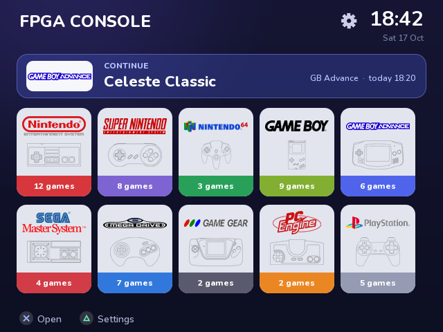
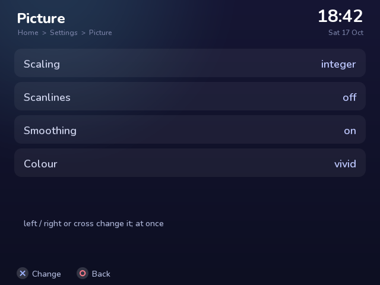

# fpga-console

### Six classic game consoles, rebuilt as hardware, on one inexpensive FPGA board.

NES · Master System · Game Gear · Game Boy · Atari 2600 · Mega Drive · Super NES · PlayStation · Nintendo 64

Plug it into a TV over HDMI, pick a console and a game from the menu, play with a
Bluetooth pad. No PC, no emulator software, no operating system underneath.

<p align="center">
  
  
</p>

---

## What makes it different

**Nothing here is emulated in software.** Every processor, graphics chip and sound
chip of every console -- the 6502, Z80, 68000, 65816, SPC700, MIPS R3000 and VR4300,
the PlayStation's GTE and GPU, the N64's RSP and RDP, the YM2612, the SPU -- is
written from scratch for this project in Verilog and runs as real logic gates
inside the FPGA. When you pick a console, the board *becomes* that console.

That means the timing comes from hardware, not from a host computer's scheduler: no
input lag from an OS, no audio crackle from a busy CPU, and the original console's
behaviour reproduced cycle by cycle where it matters.

## What it plays

| Console | State |
|---|---|
| **NES** | Full speed. Mappers NROM, MMC1, UxROM and MMC3 -- most of the library. |
| **Master System** | Full speed. |
| **Game Gear** | New. The Master System core with the Gear's 12-bit palette, START and stereo; the LCD's 160 x 144 tripled on the TV. Checked in simulation with homebrew; not yet on the board. |
| **Game Boy** | New. The SM83 passes all 500,000 SingleStepTests cases, blargg's cpu_instrs and instr_timing, and dmg-acid2 pixel for pixel, in simulation. MBC1/3/5. Not yet on the board; no battery saves yet. |
| **Atari 2600** | New. TIA, RIOT and the 6507 (the NES's 6502 with RDY); bank switching 2K-32K incl. F8/F6/F4, Super Chip, FE, E0, 3F, FA. Checked in simulation; not yet on the board. |
| **Mega Drive** | Full speed, stereo FM and PSG; cartridges up to 4 MB. |
| **Super NES** | New. Super Mario World plays; save RAM kept on the SD card. The 65816 and SPC700 are bus-cycle exact against over 750,000 recorded test cases. No enhancement chips (Super FX, SA-1) yet. |
| **PlayStation** | Boots the real BIOS from your own dump and plays commercial games from disc images on the SD card -- Crash Bandicoot, Syphon Filter, Gran Turismo 2, Resident Evil 2 -- at the console's own frame rates (Crash 30 fps, Syphon Filter 20, as on a real PlayStation). Memory cards, CD audio, XA streaming audio and FMV movies. |
| **Nintendo 64** | Super Mario 64 and Mario Kart 64 play at close to full speed (SM64 at 27-30 of its 30 frames a second), with the picture at the N64's own 59.82 Hz. The graphics chip still lacks a few modes. |

Video settings on the TV menu: sharp or smooth scaling, scanlines, and the N64's own
video filters (anti-aliasing, de-dithering) switchable per taste.

## How it is checked

A core is only as good as the evidence that it behaves like the original, so every
part is held against independent references rather than "looks right":

- **CPUs:** Klaus Dormann's 6502 suite and the nestest log; ZEXDOC/ZEXALL for the
  Z80; the SingleStepTests recordings for the 65816 and SPC700 (every instruction,
  every bus cycle); gilyon's SNES CPU and SPC tests; a self-checking 2,500-case
  program for the R3000; krom's N64 CPU, RSP and RDP test ROMs.
- **Graphics and sound:** GTE results recorded on a real PlayStation; bit-exact
  models of the PlayStation's SPU and the N64's RSP and RDP, compared word for word
  with the hardware; frames captured from the running board and replayed through
  the models.
- **Real games, measured:** frame rates on the board against the real console and
  against DuckStation; bugs traced to the instruction that causes them (most
  recently: Tekken 2 needed the R3000's load-delay slot on coprocessor moves).

## The hardware

All off-the-shelf parts:

| Part | Role |
|---|---|
| **QMTECH Artix-7 XC7A100T** core board (256 MB DDR3, 8 MB flash) | the consoles |
| **HDMI breakout** on header U4 | picture and sound to the TV |
| **LilyGO T8** (ESP32) with a microSD card | the menu, the games, Bluetooth pads |

PlayStation, Xbox and Switch pads connect over Bluetooth. **[docs/GUIDE.md](docs/GUIDE.md)**
is the step-by-step guide: parts, wiring, first programming, the SD card, playing.

## How it fits together

```
   TV <--HDMI-- FPGA (one console at a time) --SPI-- ESP32 --- SD card
                 |                                     |      cores, games, saves
                 +-- flash: the shell + one console    +--- Bluetooth pads
                 +-- DDR3: cartridges, RAM, VRAM
```

- **Each console is its own FPGA image** and gets the whole chip. A small resident
  image, *the shell*, writes the chosen console into the flash and starts it,
  showing its progress on the TV.
- **The ESP32 runs the menu** (drawn as text over the HDMI picture), streams games
  from the SD card into the console -- every chunk checked against a sum the FPGA
  keeps -- and passes the pads through. PlayStation discs are read from the card
  sector by sector as the game asks for them.
- **Saves live on the SD card:** PlayStation memory cards (in the format DuckStation
  reads), N64 EEPROM and SNES save RAM.
- **Out to the TV:** 640 x 480 HDMI with HDMI audio, 48 kHz or 44.1 kHz.

## Repository layout

```
rtl/        the consoles and the board: nes, sms (z80, vdp), md_* (m68k, ym2612),
            snes_*, ps1_* (r3000, gte, gpu, spu, mdec, cdrom), n64_* (vr4300, rsp, rdp);
            hdmi_tx, osd, shell_top, esp_bus
esp32/      the ESP32 firmware: the menu, game loading, Bluetooth pads
sim/        testbenches (tb_*.v)
tools/      build, flash, simulation and release scripts; per console the reference
            models, tests and board debugging tools (tools/README.md)
boards/     constraints for the QMTECH board, HDMI, DDR3
docs/       the guide, and design notes for each console
```

## Building from source

    ./tools/core.sh nes | sms | gg | gb | a26 | md | snes | ps1 | n64 | shell   # an FPGA image (Vivado 2026.1)
    RELEASE=1 ./tools/core.sh ...                     # the shipping image: no debug hardware
    ./tools/sim.sh tb_ps1_tekseq                               # a testbench

The PlayStation and N64 fill the chip: they build with `EFFORT=1` and `AREA=1`. The
ESP32 firmware builds with the Arduino CLI ([esp32/README.md](esp32/README.md)).
[tools/README.md](tools/README.md) lists the models, tests and board-debugging tools.

## Status and what's next

Version **0.2.0** with much since -- see [CHANGELOG.md](CHANGELOG.md) and
[docs/ROADMAP.md](docs/ROADMAP.md). Known gaps right now:

- **Nintendo 64:** YUV textures and a few RDP modes; Super Smash Bros. does not boot yet.
- **PlayStation:** some high-resolution (480i) menus, such as Gran Turismo 2's, are garbled.
- **Super NES:** no enhancement-chip cartridges yet; the core is days old and
  still meeting new games.

## Supporting the project

This is built in spare time, one console chip at a time. A Patreon is on the way for
anyone who would like to help it along -- the link will be here. In the meantime, the
most useful things are trying it on your own board and reporting what a game does.

## Legal

**No games, BIOS images or other copyrighted data are included, and none will be.**
Use dumps of games and of a BIOS you own. Nintendo, Sega, Sony and PlayStation are
trademarks of their owners; this project is not affiliated with any of them.

**No licence has been chosen yet.** Until one is added, all rights are reserved.
Bluepad32, used for the Bluetooth pads, is Apache-2.0 and runs on BTstack, which is
free for non-commercial use only.
