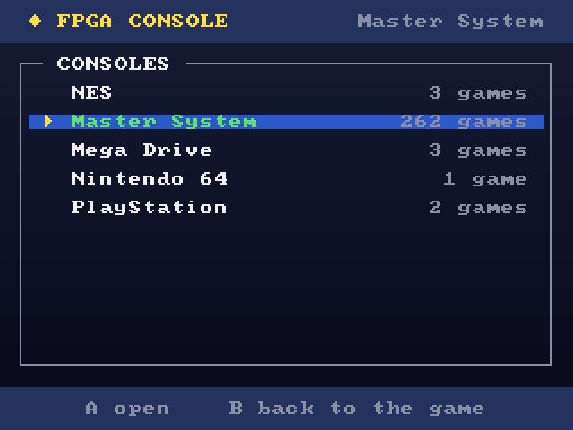
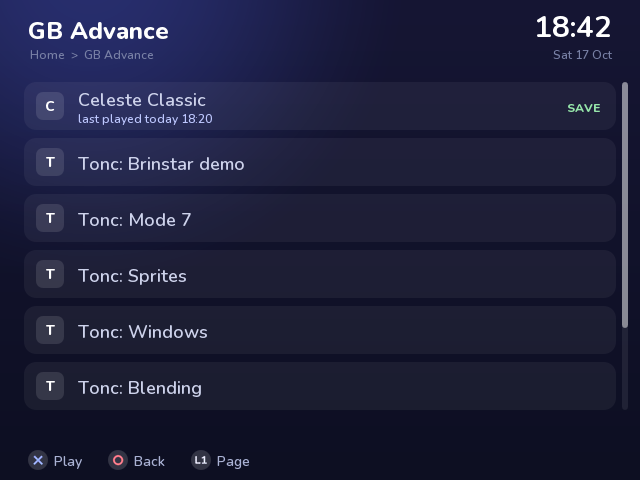

# fpga-console

**Five game consoles in hardware on one inexpensive FPGA board:** the NES, the Sega
Master System, the Sega Mega Drive, the Sony PlayStation and the Nintendo 64. It
plugs into a TV over HDMI, shows a menu, loads games from an SD card, and takes
PlayStation, Xbox and Switch pads over Bluetooth. No PC.

Nothing is emulated in software: every CPU, video chip and sound chip is written for
this project in Verilog and runs as logic in the FPGA. The board becomes whichever
console you pick.

<p align="center">
  
  
</p>

## What it plays

| | |
|---|---|
| **NES** | Full speed. Mappers NROM, MMC1, UxROM, CNROM, MMC3, AxROM. |
| **Master System** | Full speed. |
| **Mega Drive** | Full speed, stereo; cartridges to 4 MB. |
| **PlayStation** | Boots the real BIOS and plays commercial games -- Crash Bandicoot at 30 frames a second -- with memory cards, CD audio and XA. Discs from the SD card. |
| **Nintendo 64** | Super Mario 64 runs; slower than the real console in busy scenes, and the graphics chip is still being completed. |

Each is checked against independent references: Klaus Dormann's 6502 test and the
nestest log, ZEXDOC and ZEXALL for the Z80, a self-checking program for the 68000,
krom's N64 tests, GTE vectors recorded on a real PlayStation, and bit-exact models of
the PlayStation's SPU and the N64's RSP and RDP. [docs/CONSOLES.md](docs/CONSOLES.md)
has how each machine is built.

## The hardware

| | |
|---|---|
| **QMTECH Artix-7 XC7A100T** core board | the consoles (256 MB DDR3, 8 MB flash) |
| **HDMI breakout** on header U4 | the picture and the sound |
| **LilyGO T8** (ESP32-WROVER) with a microSD card | the menu, the games, Bluetooth pads |
| **LAN8720** module | the consoles' clock (and Ethernet, for development) |

**[docs/GUIDE.md](docs/GUIDE.md) is the guide to building one:** the parts, the
wiring, the first programming, the SD card, and how to play.

## How it fits together

```
   TV <--HDMI-- FPGA (one console at a time) --SPI-- ESP32 --- SD card
                 |                                     |      cores, games, saves
                 +-- flash: the shell + one console    +--- Bluetooth pads
                 +-- DDR3: cartridges, RAM, VRAM
```

- Each console is its own FPGA image, so it has the whole chip. **The shell**, a small
  image at the start of the flash, writes a console into the flash and starts it; it
  shows its progress on the TV.
- The **ESP32** draws the menu (as text over the HDMI picture), loads games from the
  SD card into the console over four wires -- every chunk checked against a sum the
  FPGA keeps -- and passes the pads through. Switching console takes about a minute;
  another game for the same console a few seconds.
- The picture is scaled to 640 x 480 and the sound goes out as HDMI audio (48 kHz, or
  44.1 kHz for the PlayStation and N64).

## Repository layout

```
rtl/        the consoles and the board: nes, sms (z80, vdp), md_* (m68k, ym2612),
            ps1_* (r3000), n64_* (vr4300, rsp, rdp); hdmi_tx, osd, shell_top, esp_bus
esp32/      the ESP32 firmware: the menu, game loading, Bluetooth pads
sim/        testbenches (tb_*.v) and models
tools/      build, flash and simulation scripts, models, board debugging
boards/     constraints for the QMTECH board, HDMI, the LAN8720, DDR3
pc/ web/    the development server and page (docs/DEVELOPMENT.md)
docs/       the guide, and design notes for each part
```

## Building from source

    ./tools/core.sh nes | sms | md | ps1 | n64 | shell      # an FPGA image (Vivado 2026.1)
    ./tools/sim.sh tb_md_vdp                               # a testbench

The N64 needs `AREA=1` and the PlayStation `EFFORT=1` (they fill the chip). The
ESP32 firmware builds with the Arduino CLI; [esp32/README.md](esp32/README.md) has
the commands. [docs/DEVELOPMENT.md](docs/DEVELOPMENT.md) covers the development setup
over Ethernet, the register bus and debugging a running core.

## Status

Release **0.2.0** -- [CHANGELOG.md](CHANGELOG.md).

- **Nintendo 64:** below full speed, so its sound breaks up; the graphics chip
  lacks some modes.
- **PlayStation:** about one frame in ten can be late on busy scenes.
- The consoles take their 50 MHz clock from the LAN8720 module, so it has to be
  plugged in even without a network.

## Legal

**No games, BIOS images or other copyrighted data are included, and none will be.**
Use dumps of games and of a BIOS you own. Nintendo, Sega, Sony and PlayStation are
trademarks of their owners; this project is not affiliated with any of them.

**No licence has been chosen yet.** Until one is added, all rights are reserved.
Bluepad32, used for the Bluetooth pads, is Apache-2.0 and runs on BTstack, which is
free for non-commercial use only.
