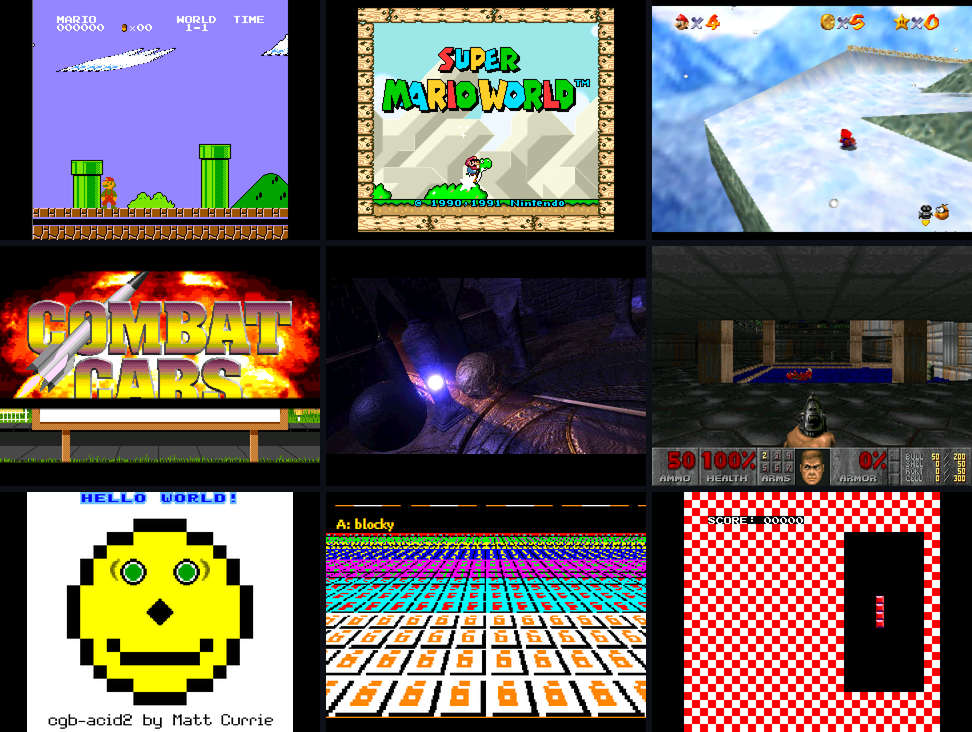

# fpga-console

Game console and DOS PC cores for the QMTECH Artix-7 XC7A100T board, with HDMI output, an
ESP32-based menu and Bluetooth controllers.

<p align="center">
  
</p>

## Supported systems

| System | Status | Notes |
|---|---|---|
| NES | Playable | Mappers 0, 1, 2, 3, 4, 7 |
| Master System | Playable | |
| Game Gear | Playable | |
| Game Boy / Game Boy Color | Playable | MBC1, MBC3, MBC5. No battery saves yet |
| Game Boy Advance | Playable | Uses the open Cult-of-GBA BIOS unless a BIOS file is provided |
| Atari 2600 | Playable | Bank switching up to 32 KB |
| Mega Drive / Genesis | Playable | Cartridges up to 4 MB |
| Super NES | Playable | No enhancement chips (Super FX, SA-1, DSP) |
| PC Engine / TurboGrafx-16 | Playable | HuCards only |
| PlayStation | Playable | Requires a BIOS file. Some 480i menus display incorrectly |
| Nintendo 64 | Partial | Super Mario 64, Mario Kart 64. Some RDP modes are missing |
| DOS PC (486) | Partial | ao486 at 62.5 MHz or z486 with FPU at 40 MHz. Doom, Quake, Rayman, Transport Tycoon Deluxe |

Details for each system are in [docs/CONSOLES.md](docs/CONSOLES.md); open issues and plans in
[docs/ROADMAP.md](docs/ROADMAP.md).

## How it works

Only one system is loaded at a time. A small resident FPGA image, the shell, writes the selected
system's image into the board's flash and boots it. The ESP32 runs the menu, loads games from the
SD card, and forwards controller input. Large games and the PlayStation's and PC's disk images
are read from the SD card on demand.

## Hardware

- QMTECH Artix-7 XC7A100T core board (256 MB DDR3)
- An HDMI breakout connected to header U4
- A LilyGO T8 (ESP32) with a microSD card, connected to header U2
- A JTAG cable for programming the shell once

Wiring and setup: [docs/GUIDE.md](docs/GUIDE.md).

## Building

Requirements:
- Vivado 2026.1
- Arduino CLI with the `esp32-bluepad32` platform
- Python 3
- WSL with `mtools` and `nasm`, for DOS disk images

```sh
./tools/core.sh <system>      # nes sms gg gb gba a26 md snes pce ps1 n64 pc shell
```

The image is written to `cores/<system>.bin`. Building the ESP32 firmware is described in
[esp32/README.md](esp32/README.md), and development tools in [docs/DEVELOPMENT.md](docs/DEVELOPMENT.md).

## Credits

The DOS PC uses [ao486](https://github.com/alfikpl/ao486) (Aleksander Osman),
[486Tang](https://github.com/nand2mario/486tang) and [z486](https://github.com/nand2mario/z486)
(nand2mario), parts of MiSTer's ao486, and Greg Taylor's OPL3. The Game Boy Advance core includes
the [Cult-of-GBA BIOS](https://github.com/Cult-of-GBA/BIOS). See
[docs/THIRD_PARTY.md](docs/THIRD_PARTY.md) for licences.

## License

No license has been chosen yet. Third-party components keep their own licences.

This repository contains no games or BIOS files. Use your own copies.
