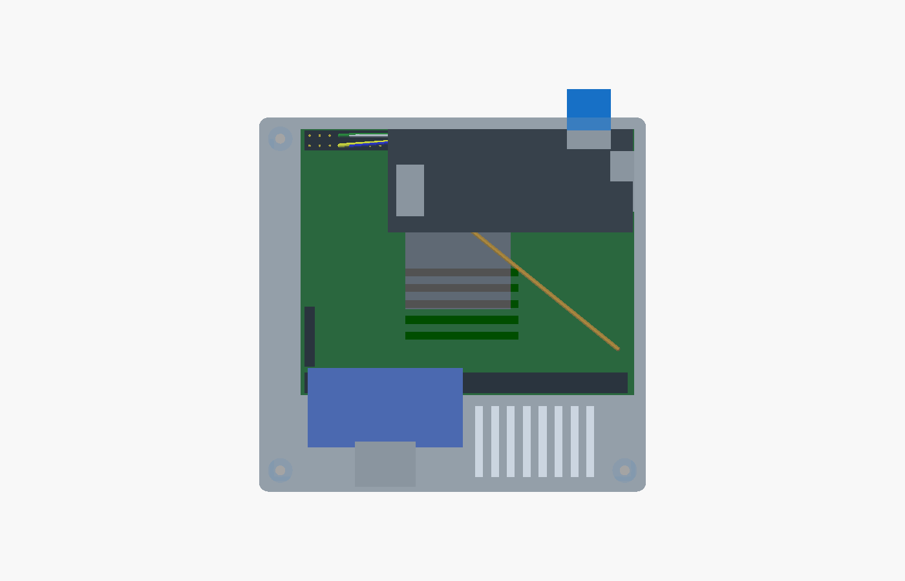

# The case

A two-part printed case for the console: the QMTECH board in the base, the HDMI
socket in the wall opposite the SD-card slot (the far side when you read FPGA
CONSOLE on the lid), and the LilyGO T8 face up under the lid, above the barrel
jack. About 97 x 94 x 29 mm closed, plain rounded box, screw posts inside.



```
            HDMI wall (opposite the SD slot)
          +----------[HDMI]------------------------+
          |(o)     +-breakout-+                (o) |
          |        |  U4 sockets ============      |
          |  [FPGA]                          jack =| <- 5 V barrel
          |          +---------- T8 ----------+    |
          |          | antenna          USB ->|   =| <- micro-USB
          |(o)       +------------[SD]--------+    |
          |    [7-10] U2 pins ==========[61][63]   |
          +-------------------------||-------------+
                SD wall       card sticks out ~7 mm
                                          (o) = screw post, inside
```

## Files

| file | what |
|---|---|
| `console_case.scad` | the model, parametric. Every dimension is named and sourced in a comment |
| `stl/base_print.stl` | base, floor on the bed |
| `stl/lid_print.stl` | lid, already turned top-down for printing |
| `stl/hdmi_fit_test.stl` | **print this first**: just the piece of wall around the HDMI opening, 32 x 29 mm |
| `renders/` | previews |

Regenerate any of them with OpenSCAD:

    openscad -D 'part="lid_print"' -o stl/lid_print.stl console_case.scad

## Print

PLA or PETG, 0.2 mm layers, 3 walls, 15-20 % infill, **no supports**. Every
overhang is a short bridge (vents, SD slot, USB opening). All four parts fit an
Ender-3 V3 SE bed.

## What is measured and what is guessed

| thing | source | confidence |
|---|---|---|
| QMTECH outline 84.1 x 67.1, header pin positions | vendor manual fig. 2-1, `docs/BOARD.md` | measured by vendor |
| DC jack position | vendor PCB drawing | good; the hole has 0.6 mm margin |
| T8 outline, M2 holes, header rows, USB | LilyGO `T8_V1.7.dxf` | exact |
| wiring: short wires soldered to the T8 and onto U2 7-10, 61 (GND), 63 (5 V); GPIO32 to SW1 | the session that wired it, 2026-10-06 | as built (the lid assumes nothing taller than a soldered pin on U2) |
| T8 microSD: small holder (TF-CKT01-009D) at the T8's right edge past the bolt hole; the card goes in flat from the side and sticks out ~10 mm | DXF part outline + the user, looking at the board | position exact; card height above the T8 assumed 0.9 mm (slot 1.8 tall) |
| T8 micro-USB 7.6 x 2.6, overhangs the PCB by 0.36 | DXF part J1 | exact |
| HDMI type A plug 13.9 x 4.45 | HDMI spec | exact |
| 5.5 x 2.1 barrel plug, sleeve 5.5 mm, 9.5 mm long | standard | exact |
| HDMI breakout: 39 x 20 mm, the 2x10 header along the 39 mm length, the socket on top at the opposite long edge sticking out ~10 mm | the user + their photo | measured |
| **header row to the breakout's edge (2.5 mm), socket centred along it** | not recorded | **GUESS** |
| header heights (2.5 + 6 male, 8.5 female, 14 Dupont) | standard parts | typical |

The HDMI guess is the only number here that can scrap a print. So:

1. Print `hdmi_fit_test.stl`: the piece of wall around the HDMI opening.
2. Hold it against the plugged-in breakout: the opening should line up with the
   socket's mouth, and an HDMI plug should go all the way in through it.
3. If it doesn't, measure and edit `hb_edge`, `hs_out` or `hdmi_mouth_z` at the
   top of the `.scad`, then re-export. Everything else follows.

## Assembly

You need:
- 3 x M3 x 16 screws (self-tapping or thread-forming, into 2.5 mm pilots)
- 3 x M2 x 6 screws for the T8
- 4 rubber feet up to 10 mm across
- a stick-on FPGA heatsink, up to 15 mm tall (see Heat below)
- the T8 wired with short wires soldered to its pads (no header pins: there is
  no room for them under the lid)

1. Drop the QMTECH into the base. It sits on two ledges along the short edges and
   is boxed in by four corner stops. It has no mounting holes, so nothing screws
   into it.
2. Screw the T8 under the lid, face up: M2 screws from below, through the T8,
   into the three standoffs. Its micro-USB lines up with the small opening in
   the right wall, its card side with the slot in the front wall.
3. Lower the lid onto the base (the T8's wires to U2 and SW1 stay soldered).
   Push the card in through the front slot; about 7 mm of it stays outside.
4. Lower the lid. The lip drops inside the base wall. Fingers on the lid's
   underside then press the board down at both short edges, hold the U4 socket
   strip, and sit on top of the HDMI socket so pulling a cable can't lift the
   breakout off its header.
5. Three M3 screws from the top into the posts inside the corners; the heads sit
   flush in the lid. The fourth corner (front-right, by the card and the jack) has
   no room for a post; the lid's lip holds it.

To open it: take the card out, undo the screws, and lift the lid as far as the
T8's short wires allow.

## Openings

| where | what | note |
|---|---|---|
| opposite the SD slot | HDMI | the plug's opening only (14.4 x 5.0); the socket sits in a pocket inside the wall, 1.2 mm behind its face |
| right, low | 5 V barrel | 6.6 mm round, for the 5.5 mm sleeve |
| right, above it | T8 micro-USB | 8.0 x 3.1 through the wall, with a 12 x 9 pocket outside for the plug body (0.4 mm of wall left), so the plug goes all the way in |
| front | microSD | 11.6 x 1.8; the seated card sticks out ~7 mm to pull it |
| lid | exhaust slots over the FPGA, side vents | floor slots behind the board are the intake |

The QMTECH's own LEDs and its two keys are covered. PROGRAM_B, the way back to
the shell, is the ESP32's job, through the wire soldered to SW1.

## Heat

The PlayStation and N64 cores fill most of the chip. Nobody has measured its
temperature in open air, and in a box it will only run warmer, so fit a stick-on
aluminium heatsink (14-20 mm square, up to 14 mm tall; under the T8's back edge, from
Y 41 forward, only 9 mm) under the exhaust slots. If it still
runs hot, the lid's vent field is centred on the FPGA, so a 30 mm 5 V fan can be
glued over it later.
